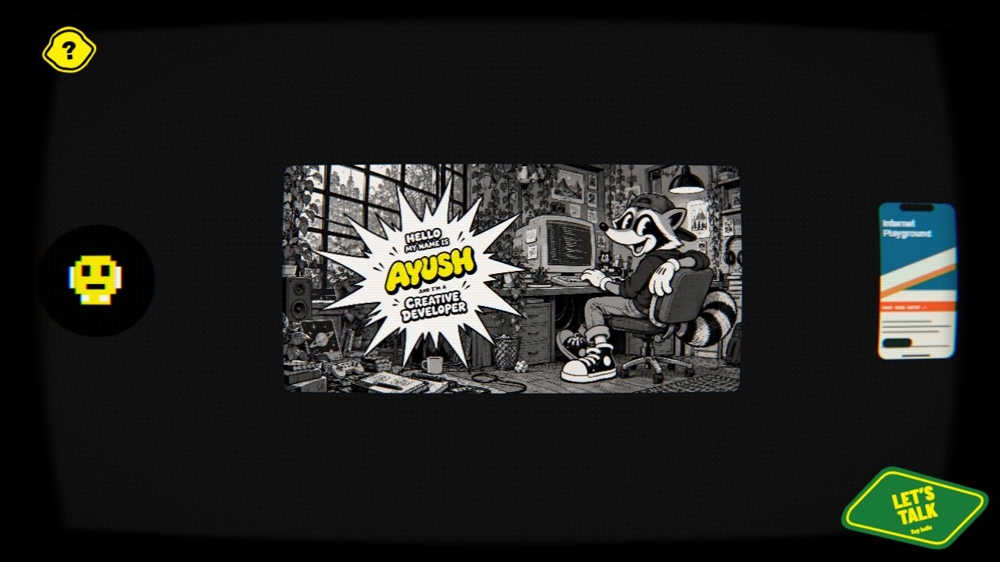
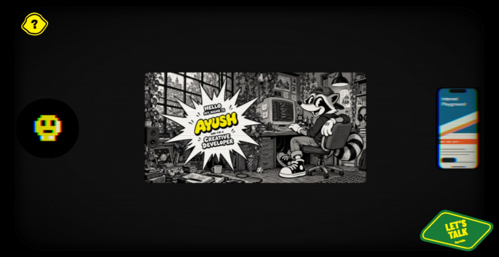
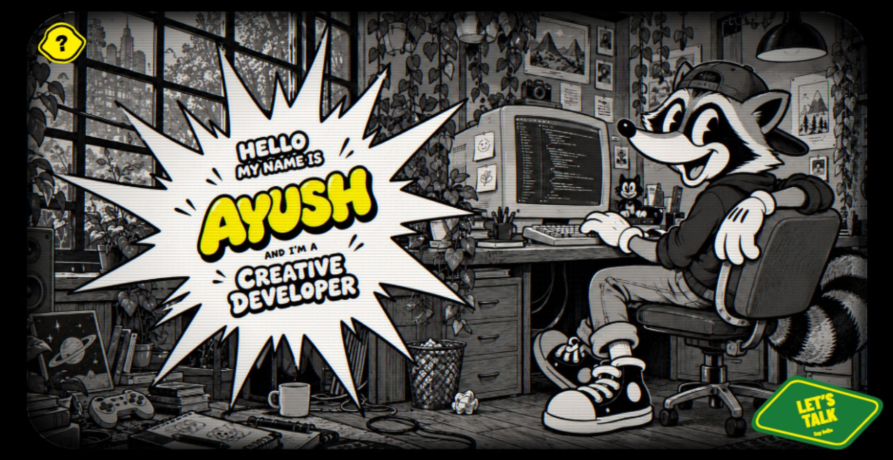
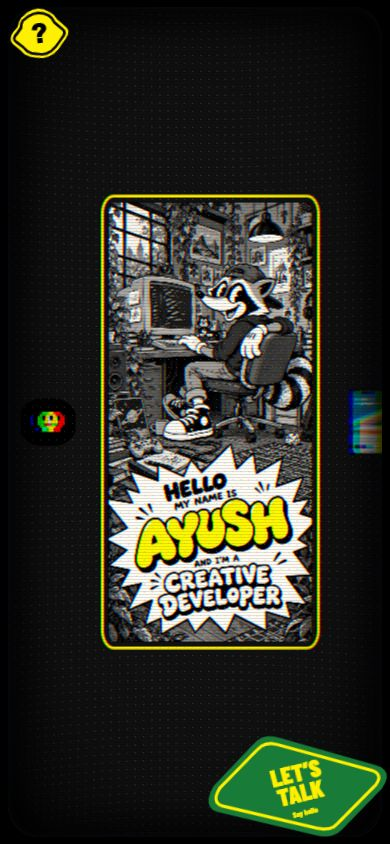

# Verification — current reference rebuild

The local portfolio remains at http://127.0.0.1:5178/. Nothing has been published or deployed.

## Current visual implementation

The default view was rebuilt around the user's reference screenshot, rather than retaining the earlier card layout. It now contains a nearly full-viewport dark CRT, centered 2:1 illustrated identity, a peripheral disc and phone preview, a yellow irregular help sticker, and a green contact sticker. The extra heading, footer controls, project captions, scribble, and hard neon border have been removed from the visible default view. The broadcast ticker is a draggable board item below the initial viewport.

At a measured **1920 × 990** viewport, the CRT bounds were approximately **x 58, y 25, width 1805, height 941**. The central artwork is approximately **851 × 426**; its final horizontal position was adjusted to approximately **x 558**, matching the reference screenshot's composition much more closely. These are layout measurements, not a pixel-perfect assertion.

The illustrated identity now uses original generated grayscale cartoon studio artwork with yellow AYUSH lettering, plus a portrait composition for narrow/tall screens. The asset is shared by the board, startup, and expanded view. Startup shows the full illustration before zooming down into the board; clicking the center reverses that interaction. The expanded view has subtle pointer depth and returns on click or Escape. Dragging does not accidentally open or close it. The previous mascot-wink/frequency UI was removed.

The current board and expanded identity render through a custom two-pass WebGL2 pipeline. A scene framebuffer feeds a GLSL glass shader with nonlinear barrel curvature, radial RGB separation, curved phosphor dots, scanlines, restrained grain, vignette and soft edges. DOM controls retain their semantics. Project/help/contact content uses the readable DOM optics fallback. Rendering is resolution-capped and pauses when hidden or covered by an overlay.

The frontend now uses Next.js 16 with React and Turbopack, replacing Vite at the user’s request to use the reference technologies. Express and shared API contracts remain separate. Dragging now has damped following, velocity-based release momentum, elastic bounds and subtle glass deformation. Pointer coordinates are mapped through the glass distortion for hit-testing and zoom anchoring.

## Automated verification

`npm run check` passed both TypeScript checks and ten automated tests:

- Health/profile/list/detail endpoints, valid content, allowed/disallowed CORS origins, invalid ID, missing project, and missing endpoint responses.
- Repository failure returns a generic consistent 500 without leaking internal details to the client.
- Pointer zoom anchoring.
- Pinch scaling and midpoint translation, including at maximum zoom.
- Tap versus drag threshold.
- Both zoom limits, 45% and 220%.
- Camera follow consistency at 60 and 120 Hz.
- Analytic coast integration at different frame rates.
- Continuous outer-bound resistance.
- Curved-glass pointer mapping.

`npm run build` passed for Express and Next.js/Turbopack, including copying the content JSON into the backend output. The workspace development command remains `npm run dev`.

## Browser verification

The reference was studied live and the rebuilt composition was compared with the supplied reference at the same 1920 × 990 size. Browser checks covered:

- Styled API loading state while connecting.
- Empty projects safely skip startup and show STAY TUNED; three sample records were restored after this check.
- Board composition, asset loading, and original artwork lettering.
- Central-card expansion and return to the board.
- Pointer response in the expanded view; dragging leaves it open.
- Opening by Enter and returning focus to the originating graphic.
- Dedicated help by click and the question-mark key from the expanded view, and the help screen's Home/reset control.
- Page Up from the board wraps to the final sample channel.
- Opening sample channel 1, then navigating to channel 2 with an arrow key.
- The portrait image source and narrow mobile layout, without horizontal overflow.
- Normal contact fallback without invented email, links, or availability.

The earlier backend-failure/retry, empty-project, persisted-shortcut, wheel-limit, Tab focus, and board-drag checks remain relevant; those underlying implementations are retained. Screenshots from the previous visual design are historical and should not be used to assess the current appearance.

## Current WebGL and drag browser checks

The live reference was dragged again to examine how the content follows the pointer. The updated local application was checked at actual browser viewport sizes of **981 × 932** and **1280 × 720**:

- WebGL2 was active for the board and expanded illustration; the GL error status was zero during inspection. No browser console errors or warnings were captured.
- SVG previews initially uploaded as black rectangles; rasterizing them once into a 2D surface before upload fixed the disc and phone textures. The corrected previews were verified visually.
- A drag beginning on the central artwork moved the board and entered the coasting state without opening a dialog. It subsequently settled to idle.
- Wheel zoom reached 220% and 45%; Home restored position and scale.
- Clicking the center expanded the illustration, Escape returned, number 1 opened the games channel, and Right changed to the websites channel.
- Help opened correctly. Switching single-key shortcuts off, reloading, and reopening help preserved OFF. It was restored to ON afterward.
- Tab focused the central illustration and Enter expanded it. Closing restores focus after React removes the inert state; the actual DOM active element was verified as the artwork button.
- No horizontal page overflow occurred in the checked views.

The viewport override did not apply in the current browser session, so a fresh narrow-mobile render of the new GPU version could not be verified. Earlier mobile layout checks refer to the DOM version; do not treat them as a new GPU-device check. Physical multi-touch, reduced-motion OS settings and non-Chromium browsers still need review.

## Remaining limits

- **Not an exact 1:1 copy.** The detailed AYUSH/raccoon illustration is an original personalized replacement; the reference creator's exact artwork, name, projects, and availability were not copied into this portfolio. Generated artwork and prompts are documented in [ARTWORK.md](ARTWORK.md).
- The reference's nonlinear image distortion and precise animation physics remain approximations. Frame geometry and startup/expansion were compared visually, but a pixel-diff or measured animation-timing audit was not performed.
- The three projects remain explicitly labeled samples. The left/right board previews are original placeholder representations.
- Physical touch/pen hardware, a real multi-touch pinch, Safari/Firefox, assistive-technology sessions, and an OS-level reduced-motion session remain unverified. Reduced-motion branches are implemented in CSS, the camera, shader and Web Animations API, and pinch geometry is unit tested.
- Contact says “LET’S TALK” rather than inventing an “OPEN TO WORK” availability claim.
- The identity lettering is baked into the optimized JPEGs. Changing the name/role in the illustrated image requires replacing or regenerating the assets.

## Current GPU screenshot

## Earlier composition screenshots

## Cursor drift update

Added a damped whole-screen translation toward a fine-pointer cursor, capped at 6px horizontally and 4px vertically. Browser inspection verified leftward and rightward response with the board camera at its reset transform. A drag still moved the board without opening a dialog; opening help removed the screen translation. No console errors or warnings were recorded. Type checks, all ten existing tests and the frontend production build passed. Touch and reduced-motion exclusion are implemented but were not exercised with physical devices or OS settings in this update.

### Fixed-frame refinement

Cursor drift now targets only `.crt-picture`, leaving the CRT glass, borders and corner stickers stationary. Maximum travel increased to 11px horizontally and 7px vertically. Browser checks at left and right pointer positions returned identical frame bounds while the picture translation changed direction. Frontend TypeScript validation passed.

### Hold zoom and increased cursor sensitivity

Mouse/pen press now animates a separate visual zoom multiplier to 0.95 around the grabbed point; release returns it to 1 without changing the logical camera zoom. Browser checks observed the release transition and confirmed restoration at both 100% and 118% zoom, no dialog after dragging, and successful artwork opening. The frame transform stayed empty. Cursor travel is now 15px by 10px with follow rate 9. All 11 tests and TypeScript checks passed; the added test verifies anchor preservation and original camera/zoom restoration. Reduced-motion and touch exclusions are implemented but were not tested on physical hardware in this update.

The later red/blue edge-glow experiment was reverted at the user’s request. The previous chromatic shader and intensity (0.0022) are restored; cursor motion and hold zoom are retained.
